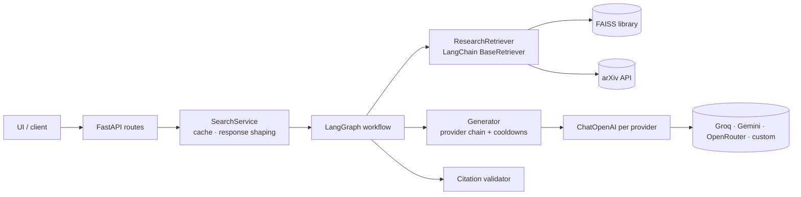

# Contexta 2.0

Ask an ML/NLP research question → get an answer grounded **only** in retrieved evidence — a curated paper library, live arXiv results, or a PDF you upload — with every `[n]` citation checked against the sources actually retrieved.

FastAPI · LangGraph · LangChain · FAISS · fastembed (all-MiniLM-L6-v2, ONNX) · arXiv API · Groq / Gemini / OpenRouter / any OpenAI-compatible server

> Contexta 2.0 is a separate project evolved from [Prit00001/Contexta](https://github.com/Prit00001/Contexta) (history preserved). Phase 1 status, evidence and known limitations: [docs/PHASE_1_COMPLETION_REPORT.md](docs/PHASE_1_COMPLETION_REPORT.md).

## What works (verified in Phase 1)

| Feature | Notes |
|---|---|
| `POST /ask` research Q&A | LangGraph workflow: validate → retrieve → generate → validate citations → respond |
| Retrieval | FAISS over a 25-paper library + optional live arXiv, hybrid-scored, de-duplicated; sources carry `document_id` and `chunk_id` |
| Grounded generation | Provider chain with per-provider cooldowns; prompt fences sources as untrusted data; one feedback-driven retry if the answer cites nothing |
| Citation validation | Hallucinated `[n]` removed and reported; answer split into claims marked `cited` / `uncited` (marker-level check — see limitations) |
| Never-down behaviour | No LLM key / all providers failing → extractive answer from top passages (`outcome: extractive_fallback`); nothing relevant → `insufficient_evidence` without calling an LLM |
| `POST /ask-pdf` | Q&A over an uploaded PDF, page-level sources |
| `GET /health`, `GET /ready` | Liveness; readiness with `ready` / `degraded` / `not_ready` and per-check reasons |
| Observability | Request IDs (`X-Request-ID`), JSON logs per request and per workflow stage, no question text or keys in logs |
| Workspace platform | Supabase-JWT/API-key auth, document upload, ingestion worker, pgvector hybrid Q&A (preserved from the baseline) |
| Web UI | Single page at `/` (unchanged; uses the backward-compatible response fields) |

Not verified from the build environment (network-restricted): live arXiv, real LLM providers, the real embedding-model download, and the Docker build. See [Known limitations](#known-limitations).

## Architecture



LangChain is confined to four adapter modules (`core/llm.py`, `core/prompts.py`, `core/lc_retriever.py`, `core/sources.py`) and LangGraph to `services/research_graph.py`. Details: [SYSTEM_DESIGN](docs/architecture/SYSTEM_DESIGN.md) · [diagrams](docs/architecture/diagrams/) · [ADR-001](docs/decisions/ADR-001-project-architecture.md).

## Prerequisites

- Python **3.11 or 3.13** (both verified). `make` optional.
- Internet access on first start (downloads the embedding model once, then cached), plus for arXiv and LLM calls.
- Optional: one free LLM key — [Groq](https://console.groq.com/keys), [Gemini](https://aistudio.google.com/apikey) or [OpenRouter](https://openrouter.ai/keys). Without one, Contexta answers in extractive mode.
- Optional: Docker (for Compose / the workspace platform's Postgres).

## Installation

```bash
python -m venv .venv && source .venv/bin/activate   # Windows: .venv\Scripts\activate
pip install -r requirements-dev.txt                  # pinned; runtime-only: requirements.txt
cp .env.example .env                                 # optional: add an LLM key
```

## Run locally

```bash
uvicorn app.main:app --reload
```

Open http://localhost:8000 (UI) or http://localhost:8000/docs (interactive API docs). Stop with Ctrl+C.

The first start downloads the embedding model (cached afterwards). Check `GET /ready`: if `embeddings` is not `ok`, the model couldn't be loaded and retrieval is running on low-quality hash vectors.

### Offline demo of the full LLM path (no API key)

```bash
python scripts/fake_llm_server.py --port 9009          # terminal 1: deterministic OpenAI-compatible stub
LLM_PROVIDERS=custom LLM_BASE_URL=http://127.0.0.1:9009/v1 LLM_MODEL=fake-llm \
  uvicorn app.main:app                                  # terminal 2
```

The stub quotes the retrieved sources with citations — it exercises the real pipeline but is not a model.

### Using OpenRouter only (or a local Ollama)

```bash
LLM_PROVIDERS=openrouter OPENROUTER_API_KEY=sk-or-... uvicorn app.main:app
LLM_PROVIDERS=custom LLM_BASE_URL=http://localhost:11434/v1 LLM_MODEL=llama3.1:8b uvicorn app.main:app
```

## Docker

```bash
docker build -t contexta .
docker run -p 8000:8000 --env-file .env contexta        # API only
docker compose up --build                               # API + worker + Postgres/pgvector (+ migrations)
```

The image installs from the lockfile and bakes the embedding model in at build time. *The Docker build was not executed during Phase 1* (registry blocked in the build environment); CI builds and smoke-tests the image.

## API usage

```bash
curl -s http://localhost:8000/ask -H 'content-type: application/json' \
  -d '{"question": "How does retrieval-augmented generation reduce hallucination?", "top_k": 3, "use_arxiv": true}'
```

Response (abridged — full example in `/docs`):

```json
{
  "answer": "RAG conditions the generator on retrieved passages ... [1]. Dense retrievers such as DPR supply them [2].",
  "outcome": "answered",
  "sources": [{"marker": 1, "title": "Retrieval-Augmented Generation for Knowledge-Intensive NLP",
               "url": "https://arxiv.org/abs/2005.11401", "document_id": "doc_004", "chunk_id": "doc_004#0", "...": "..."}],
  "citations": [{"marker": 1, "source_id": "doc_004", "chunk_id": "doc_004#0", "title": "...", "url": "..."}],
  "claims": [{"text": "RAG conditions the generator on retrieved passages ...", "markers": [1], "status": "cited"}],
  "citation_check": {"verification": "marker_only", "valid_markers": 2, "removed_markers": [], "uncited_claims": 0},
  "workflow": [{"stage": "retrieve", "status": "ok", "duration_ms": 6}, "..."],
  "provider": "groq", "model_used": "openai/gpt-oss-20b", "llm_used": true, "cached": false,
  "warnings": [], "diagnostics": [], "request_id": "3f9c1a7e2b4d6f80", "timings_ms": {"total": 1190}
}
```

| `outcome` | Meaning |
|---|---|
| `answered` | An LLM answered and cited at least one retrieved source |
| `extractive_fallback` | No LLM configured/succeeded, or its answer cited nothing twice; answer is the best sentences from the top sources |
| `insufficient_evidence` | Nothing relevant retrieved; no LLM call made |

Other endpoints: `POST /ask-pdf` (multipart `question`, `file`, `top_k`), `GET /health`, `GET /ready`, and the workspace API under `/workspaces/...` (see `/docs`). Errors: 422 invalid input, 429 rate limited (`Retry-After`), 500 generic with `request_id`, 503 retrieval unavailable.

## Configuration

All settings come from environment variables (or `.env`) and are validated at startup — an invalid value stops the server with a message naming the variable. Most-used:

| Variable | Default | Purpose |
|---|---|---|
| `GROQ_API_KEY` / `GEMINI_API_KEY` / `OPENROUTER_API_KEY` | – | Provider keys; set any |
| `LLM_PROVIDERS` | `groq,gemini,openrouter,custom` | Fallback order |
| `LLM_BASE_URL`, `LLM_MODEL`, `LLM_API_KEY` | – | Any OpenAI-compatible server (`custom`) |
| `REQUIRE_LLM` | `false` | Refuse to start without a provider |
| `LLM_MAX_ATTEMPTS` | `2` | Generation attempts per question (1–3) |
| `ARXIV_ENABLED` | `true` | Live arXiv search |
| `RATE_LIMIT_PER_MIN` | `20` | Per client IP on `/ask` |
| `LOG_FORMAT` | `text` | `json` for production |

Full reference: [docs/operations/CONFIGURATION.md](docs/operations/CONFIGURATION.md).

## Tests

```bash
pytest -q                     # unit + integration + E2E; no network, no API keys (DB tests skip)
make test-db                  # also run Postgres/pgvector tests (needs `docker compose up -d db`)
ruff check . && ruff format --check .
python scripts/smoke_test.py --base-url http://127.0.0.1:8000   # against a running server
```

Phase 1 result: **181 passed** on Python 3.13 and 3.11 (with the DB tests; 178 passed + 3 skipped without a database). Details: [TEST_REPORT](docs/testing/TEST_REPORT.md) · [TEST_STRATEGY](docs/testing/TEST_STRATEGY.md).

## Troubleshooting

| Symptom | Cause / fix |
|---|---|
| Server exits with `ConfigError: Invalid configuration - X: ...` | Fix variable `X` in `.env` / environment |
| `/ready` → `embeddings` not ok, answers poor | Embedding model couldn't download; check network, or set `FASTEMBED_CACHE_PATH` to a pre-populated cache |
| Startup takes ~45 s offline | fastembed retries the model download before falling back (Phase 2 item P2-17) |
| `outcome: extractive_fallback` | No provider key, or all providers failing — see `diagnostics[]` (e.g. `groq: API key rejected`, `model ... not found (HTTP 404); check GROQ_MODEL`) |
| `429 Too many requests` | Per-IP limit; raise `RATE_LIMIT_PER_MIN` or `0` to disable locally |
| arXiv warning in `warnings[]` | arXiv slow/unavailable; library-only answer returned |
| Workspace routes return 503 | `DATABASE_URL` or `SUPABASE_JWT_SECRET` not configured (or DB unreachable — see `/ready`) |

## Known limitations

- Citation validation is **marker-level**: it proves `[n]` points to a retrieved source, not that the source supports the claim (`verification: "marker_only"`).
- The library is 25 curated abstracts; arXiv search is keyword-based and best-effort.
- Live providers, arXiv and the model download were exercised only through mocks/stubs in Phase 1; `langchain-openai` sends `max_completion_tokens`, whose support by Gemini's OpenAI-compatible endpoint is unverified.
- Caches and the `/ask` rate limiter are per process.
- `/ask` is intentionally unauthenticated (public demo), protected by rate limiting.

## Roadmap

- **Phase 2** — evaluation set first, then claim-support checking, evidence UX, hybrid/BM25, reranking, workspace path on the graph: [PHASE_2_BACKLOG](docs/roadmap/PHASE_2_BACKLOG.md)
- **Phase 3** — research-driven query rewriting and optional local inference: [research brief](docs/research/PHASE_3_QUERY_REWRITING_RESEARCH.md)

## Project layout

```
app/        main.py (factory, lifespan) · routes.py · routes_workspace.py · routes_admin.py · deps.py
            config.py (validated settings) · schemas.py · observability.py · static/index.html
core/       llm.py · prompts.py · lc_retriever.py · sources.py · citations.py   ← LangChain adapters
            generator.py · retriever.py · vector_store.py · embeddings.py · text.py · pdf.py
            db.py · storage.py · parsers.py · chunking.py · auth.py · rate_limit.py
services/   research_graph.py (LangGraph) · search_service.py · arxiv_client.py
            workspace_qa.py · retrieval.py · ingestion.py · worker.py
data/       documents.py (paper library)
scripts/    smoke_test.py · fake_llm_server.py · migrate.py
tests/      unit · integration/ · e2e/
docs/       requirements · architecture · decisions · implementation · testing · operations · research · roadmap
```
