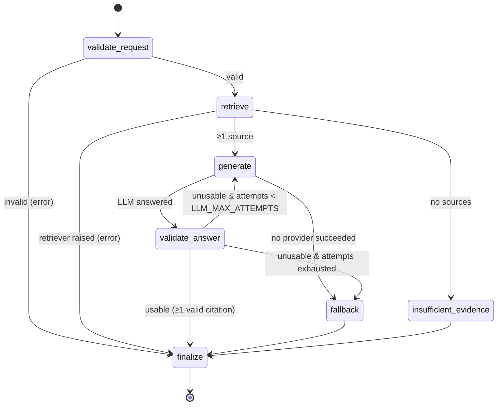
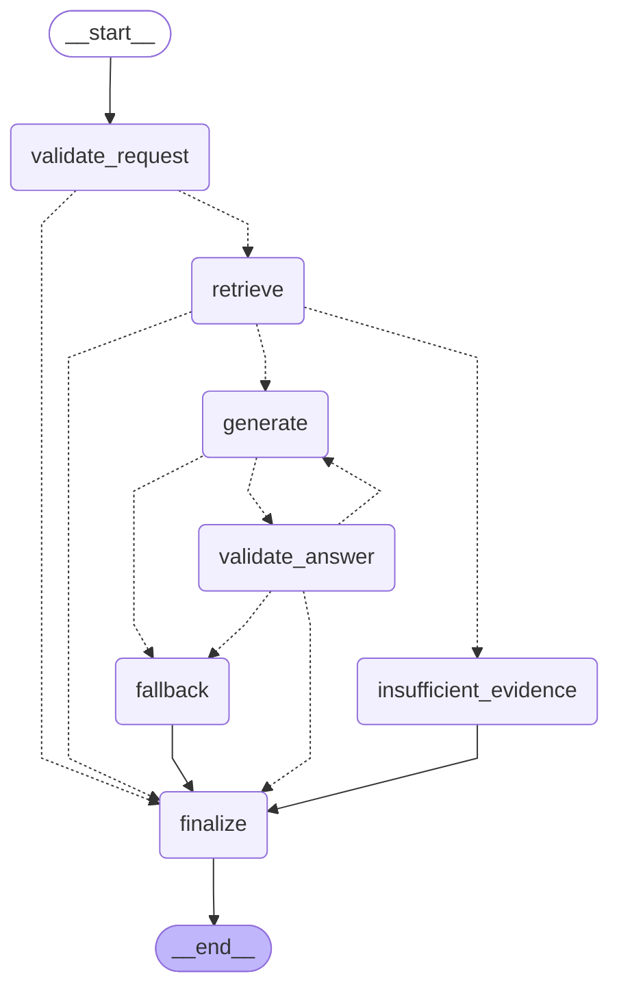

# LangGraph research workflow

Defined in `services/research_graph.py`.

| Outcome | Path |
|---|---|
| `answered` | validate_request → retrieve → generate → validate_answer → finalize |
| `extractive_fallback` | … → generate → fallback → finalize, or validate_answer → fallback |
| `insufficient_evidence` | retrieve → insufficient_evidence → finalize |
| `error` | validate_request → finalize (invalid input from non-HTTP callers; HTTP validation rejects first → 422), or retrieve → finalize (retriever raised → HTTP 503) |

## Generated from the compiled graph

Produced by `build_research_graph(...).get_graph().draw_mermaid()` (dotted = conditional edge). `tests/test_research_graph.py::test_graph_structure_matches_design` asserts the node set and key edges.

