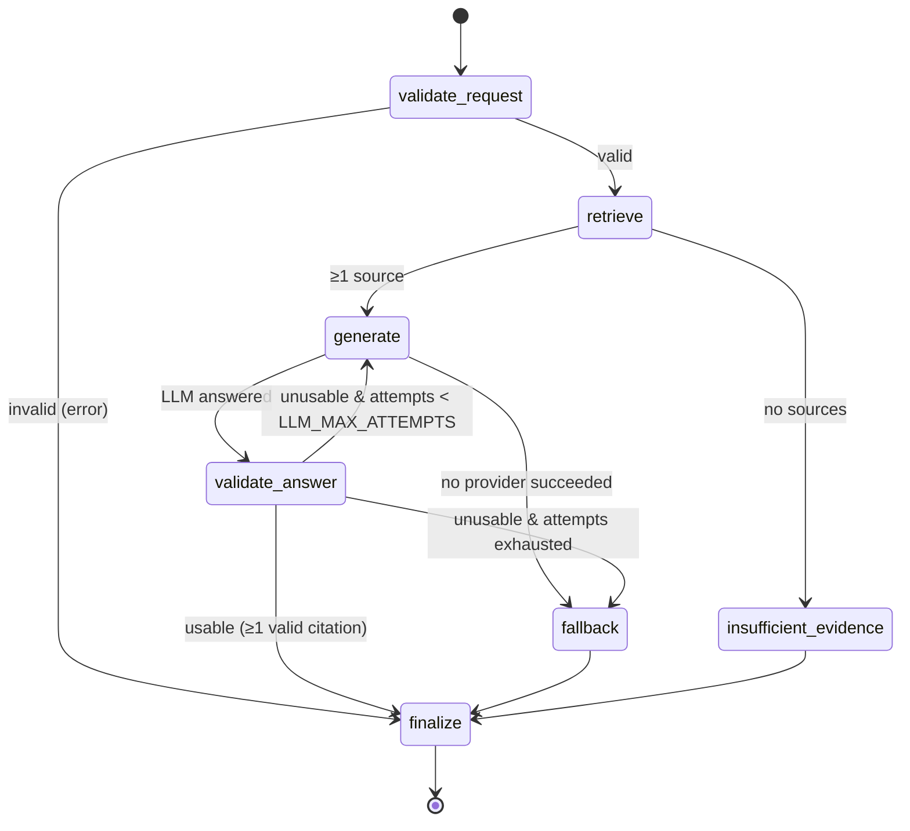

# LangGraph research workflow

Defined in `services/research_graph.py`.

| Outcome | Path |
|---|---|
| `answered` | validate_request → retrieve → generate → validate_answer → finalize |
| `extractive_fallback` | … → generate → fallback → finalize, or validate_answer → fallback |
| `insufficient_evidence` | retrieve → insufficient_evidence → finalize |
| `error` (non-HTTP callers only; HTTP validation rejects first) | validate_request → finalize |
